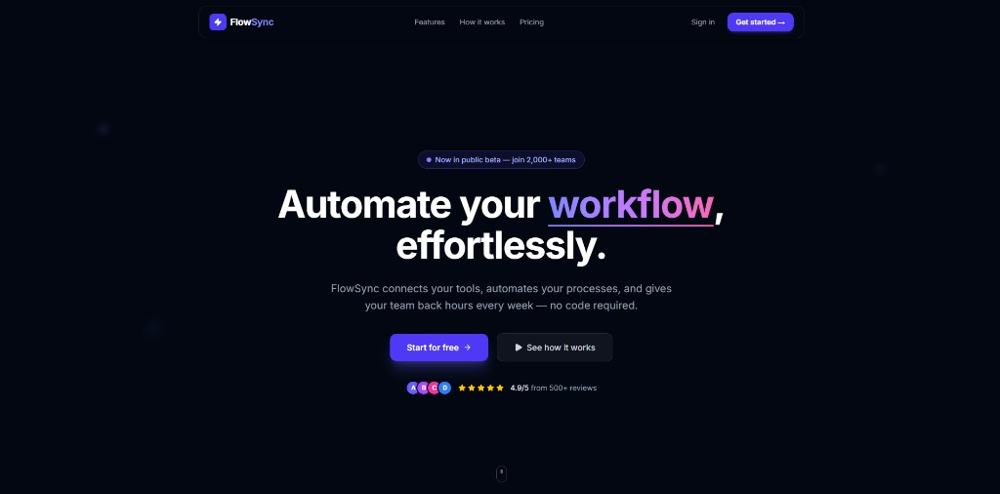
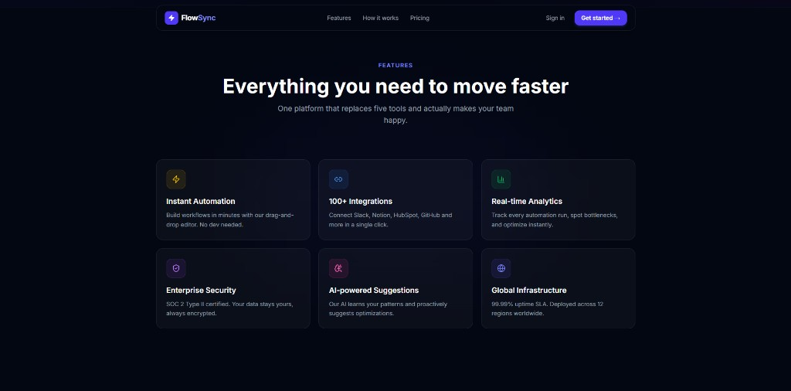
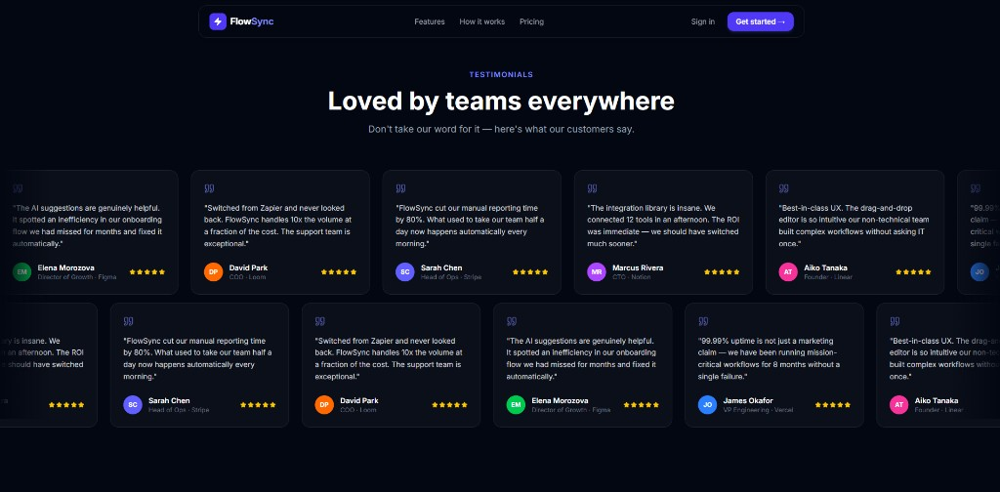
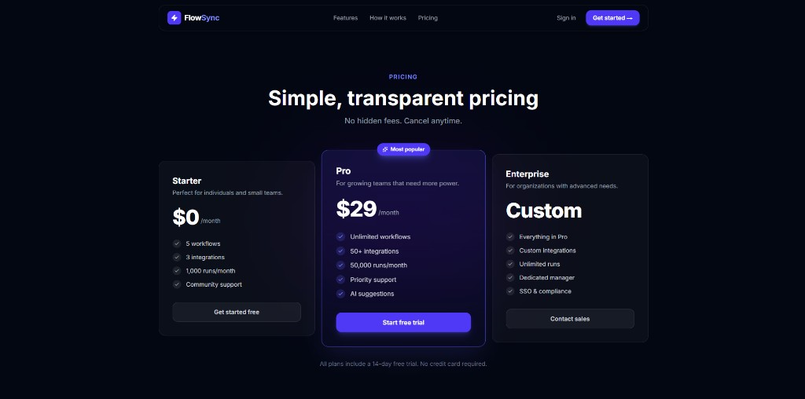
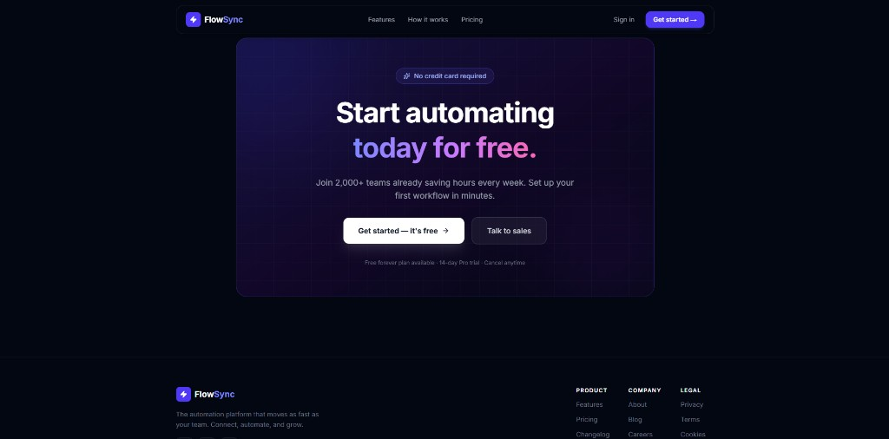

# FlowSync — SaaS Landing Page

> A modern, animated landing page for **FlowSync**, a workflow automation SaaS platform.  
> Built with React, TypeScript, TailwindCSS v4 and Framer Motion.

---

## Screenshots

### 01 · Hero


### 02 · Features


### 03 · Testimonials


### 04 · Pricing


### 05 · CTA & Footer


---

## Tech Stack

| Tool | Version | Role |
|---|---|---|
| [React](https://react.dev) | 19 | UI framework |
| [TypeScript](https://www.typescriptlang.org) | ~6.0 | Type safety |
| [TailwindCSS](https://tailwindcss.com) | v4 | Utility-first CSS |
| [Framer Motion](https://www.framer.com/motion/) | latest | Animations |
| [Lucide React](https://lucide.dev) | latest | Icons |
| [Vite](https://vite.dev) | v8 | Build tool |

---

## Getting Started

```bash
# Install dependencies
npm install

# Start dev server
npm run dev

# Production build
npm run build
```

---

## Project Structure

```
src/
├── data/
│   └── index.ts          # All static content (features, stats, testimonials, pricing...)
├── components/
│   ├── Navbar.tsx         # Sticky navbar with glassmorphism + mobile menu
│   ├── Hero.tsx           # Hero with animated glow, stagger reveal, scroll hint
│   ├── Stats.tsx          # Animated count-up KPI cards
│   ├── Features.tsx       # 6-card feature grid with hover glow
│   ├── HowItWorks.tsx     # 3-step timeline with animated connector line
│   ├── Testimonials.tsx   # Infinite dual-row marquee
│   ├── Pricing.tsx        # 3-tier pricing cards
│   ├── CtaBanner.tsx      # Final call-to-action with pulsing glow
│   └── Footer.tsx         # Links + social icons
├── App.tsx
└── style.css              # Tailwind v4 + Inter font
```

---

## Design Decisions

- **Color palette** — `gray-950` background, `indigo-600` primary accent, `purple-400` secondary. Each feature card has its own accent color.
- **Typography** — [Inter](https://fonts.google.com/specimen/Inter) (the standard for modern SaaS UIs).
- **Animations** — All scroll-triggered via `whileInView + viewport: { once: true }`. The hero uses `staggerChildren` for a cascade reveal. Testimonials use `useAnimationFrame` for a smooth infinite marquee.
- **Data layer** — All static content lives in `src/data/index.ts`, fully decoupled from components.

---

## Customization

To update any content, edit **`src/data/index.ts`** only:

```ts
// Change pricing plans
export const plans = [ ... ]

// Change feature cards
export const features = [ ... ]

// Change testimonials
export const testimonials = [ ... ]
```
